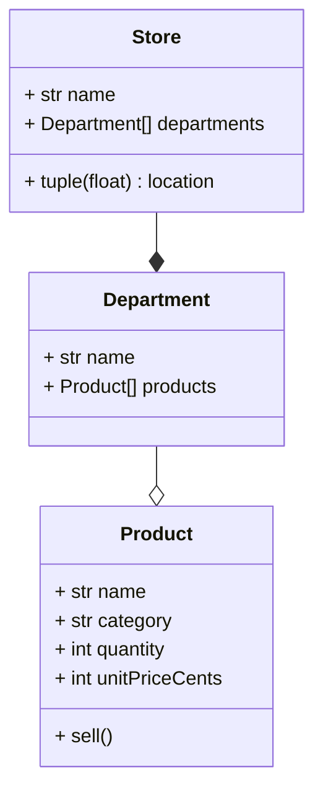

Viewing this in VS Code?

0. You may need a mermaid specific plugin, but as of VSCode 1.137.0, this seems not to be necessary
1. ctrl + shift + p OR command + shift + p
2. Type: > Markdown: open preview to side
3. View this file, but rendered nicely

If you did it correctly, this preformatted block will be a diagram:

